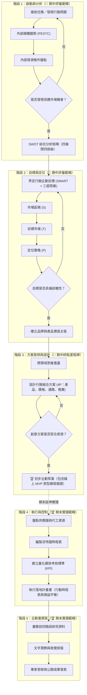

# 萬能科技大學《創意發想與實踐》期中報告操作手冊、Prompt 指引與示範案例（服飾銷售篇）

**課程名稱**：創意發想與實踐（11501） | **授課教師**：邱俊維 博士 | **教學地點**：G104 多媒體教室  
**實踐模式**：100% 個人獨立微型創業專案（零課後額外負擔）

---

## 【重要實踐守則與期中目標說明】
本課程重視每位同學的個人自主創意與數位實踐能力。期中進度採取「100% 個人獨立微型創業專案」模式。授課教師本身具備成熟的獨立品牌電商架站技術（非使用 GitHub Pages）；但考量全班同學「零伺服器主機成本、零課後額外負擔、統一公開互評與發布」，期中報告的核心要求為：**請同學們使用 Google Antigravity 做出一個初步企劃草稿的靜態網站，並部署到 GitHub Pages，取得所有人皆能檢視的公開網址交出成果！**

---

## 第一部分：Google Antigravity App (v2.28.2) 安裝與環境配置指引

為了讓每位同學的服飾企劃構想能夠快速落地並轉化為具體的數位互動原型，本課程導入先進的 Google Antigravity 應用程式。請依照以下步驟下載安裝：

### 1.1 下載與安裝 Google Antigravity 桌面版應用程式
- **官方下載入口**：[https://antigravity.google/download](https://antigravity.google/download)
- **官方更新日誌專頁 (v2.28.2)**：[https://antigravity.google/docs/changelog?tab=hub](https://antigravity.google/docs/changelog?tab=hub)
- **Google Antigravity 官方首頁**：[https://antigravity.google](https://antigravity.google)
- **操作步驟指引**：
  1. 點擊上方官方連結進入 Google Antigravity 官方下載專頁，確認版本為最新穩定版本 v2.28.2。
  2. 依據個人電腦作業系統（Windows / macOS）下載對應安裝套件（.exe 或 .dmg）。
  3. 執行安裝程式，依照畫面指示完成安裝與初始化設定。
  4. 啟動 Google Antigravity App，使用個人的 Google 帳號登入完成驗證。

> 【圖 1-1 Google Antigravity 官方 App 下載頁面真實截圖】

---

### 1.2 登入 GitHub 帳號並建立個人專案儲存庫（開 Repo）
GitHub 是全球專業軟體與企劃專案的託管平台，亦是展示個人微型創業成果的最佳舞台。
- **GitHub 官方登入入口**：[https://github.com/login](https://github.com/login)
- **GitHub 官方註冊入口**：[https://github.com/signup](https://github.com/signup)
- **操作步驟指引**：
  1. 點選上方登入連結前往 GitHub 官方頁面。已有帳號者直接登入；新同學請輸入 Email 註冊帳號。
  2. 登入後點擊右上角「+」，選擇「New repository」（新增儲存庫，即建立專案 Repo）。
  3. **專案命名規範**：建議以服飾創業主題英文命名（如 `ordinal-wear` 或 `clothing-capsule-midterm`）。
  4. **權限設定**：請務必勾選「**Public**」（公開），並勾選「**Add a README file**」。
  5. 點擊綠色按鈕「**Create repository**」完成專案儲存庫建立。

> 【圖 1-2 GitHub 官方登入介面真實截圖】  
> 【圖 1-3 GitHub 建立新儲存庫 (Create a new repository) 介面截圖】

---

### 1.3 啟用 GitHub Pages 免費雲端靜態網頁發布
GitHub Pages 能將儲存庫中的 HTML、CSS、JavaScript 檔案，一鍵發布為全世界皆可瀏覽的真實公開網站。
- **查看 GitHub Pages 官方指引**：[https://pages.github.com/](https://pages.github.com/)
- **啟用步驟**：
  1. 進入專案儲存庫頁面，點選上方功能導覽列的「**Settings**」（設定）。
  2. 在左側選單中找到「**Code and automation**」區塊，點選「**Pages**」。
  3. 在「Build and deployment」底下的「**Branch**」設定：將分支改選為 `main`，資料夾維持 `/(root)`，點擊右側「**Save**」。
  4. 等待約 1~2 分鐘重新整理頁面，頂部將出現綠色提示：「Your site is live at `https://[您的帳號].github.io/[專案名稱]/`」。
  5. 此網址即為期中報告必須提交之「**線上公開部署網址**」！

---

## 第二部分：行銷企劃 SOP 流程圖重繪與期中評量範疇解讀

本課程嚴謹依循行銷學理經典教材（凌政文 教授著《行銷企劃》圖 1-9）之五階段標準流程。授課教師特別將原圖重新繪製為現代數位流程圖，並精準標記【期中報告】與【期末報告】之學習進度邊界：

### 【行銷企劃五大階段與課程評量範疇對照】



### 【資深教授指引：期中評量邊界說明】
> [!IMPORTANT]
> 請同學們特別留意：依據專業行銷企劃 SOP，期中報告的核心目的在於驗證「**創業動機、市場定位與價值主張的邏輯合理性**」。  
> 因此，期中進度要求至【**階段 3 之產出：初步企劃草案**】即可。同學們無須過早煩惱龐大的壓貨預算編列或複雜的甘特圖工廠排程，請專注將前三階段的學理分析做紮實，並製作出清晰的線上 MVP 原型展示網頁！

---

## 第三部分：服飾銷售主題 Prompt 指引與微型創業示範案例

- **微型創業示範案例**：《質序衣研 (ORDINAL WEAR)》—— 極簡膠囊日常服飾選品  
- **品牌負責人**：授課教師示範案例（學生請換為個人姓名）  
- **核心主張**：「以減法設計重整衣櫃秩序，一件搞定日常與休閒。」主打防皺重磅純棉落肩 T、垂墜抗皺休閒西裝褲與膠囊穿搭方案。

---

### 步驟 1：【發掘痛點與創業動機 Prompt】
**微型創業示範案例**：《質序衣研 (ORDINAL WEAR)》

#### 【學生可直接複製之 Prompt 指令】：
```text
身為服飾微型創業者，我想以《質序衣研 (ORDINAL WEAR)》為題，主打「極簡日常膠囊服飾（Capsule Basics）」。請幫我從『快時尚品質與洗滌縮水退色』、『海量尺碼與庫存積壓風險』與『現代人早晨選衣障礙與穿搭內耗』三方面，提煉出 3 個具體痛點與切入緣起。
```

#### 【Google Antigravity Agent 真實輸出解析】：
1. **廉價快時尚品質痛點與版型踩雷**：市售低價網購服飾常使用化纖混紡與劣質車工，洗滌一次即領口荷葉邊變形、褪色縮水，消費者陷入「便宜買、穿不久、頻繁丟棄」的惡性循環，渴望品質紮實耐穿的基礎常態款。
2. **多尺碼多色積壓庫存成為微型創業致命傷**：傳統女裝/男裝動輒 S/M/L/XL 各四色，微型創業者資本僅 3~5 萬，極易因斷碼滯銷面臨資金斷裂；因此採用「男女共穿寬鬆微落肩版型（Relaxed Unisex Fit）」與精煉經典大地素色，大幅收斂 SKU（庫存單位），降低庫存風險。
3. **每日早晨「衣櫃很滿卻不知穿什麼」的選擇內耗**：資訊爆炸使年輕都會族群與大學生在著裝上面臨選擇焦慮，市場缺乏以「一週膠囊搭配公式」為核心、兼具舒適度與正式休閒平衡的系統性美學提案。

> 【學生操作提示】：請開啟 Google Antigravity App，在對話框中貼上上述 Prompt 指令，並觀察 AI 如何梳理出服飾市場的精準切入點。

---

### 步驟 2：【外部總體環境 PESTC 深度分析 Prompt】
**微型創業示範案例**：《質序衣研 (ORDINAL WEAR)》

#### 【學生可直接複製之 Prompt 指令】：
```text
請針對《質序衣研》的「極簡日常膠囊服飾選品（重磅防皺純棉 T-shirt、抗皺直筒休閒褲）」，運用政治法律、經濟、社會文化、科技、綠色環保五大構面進行 PESTC 總體環境分析，並說明對本服飾微型創業企劃之啟發。
```

#### 【Google Antigravity Agent 真實輸出解析】：
- **P (政治法律構面)**：消保法規定網購 7 天猶豫期與商品標示法對成衣纖維含量、洗滌標示的法規趨嚴。《質序衣研》主動標示 100% 雙股精梳棉與耐磨指數，化繁瑣法規為消費者透明信任感。
- **E (經濟環境構面)**：通膨物價上漲下，年輕人消費轉向「理性務實」，追求高 CP 值與「單品多搭」穿著壽命。千元以下高質感基本款具備極佳抗通膨韌性，搭配 60 元超商常溫取貨，大幅提高轉換率。
- **S (社會文化構面)**：Clean Fit 極簡風格、膠囊衣櫥（Capsule Wardrobe）概念在 IG、小紅書蔚為流行，青年族群拋棄過度繁複 Logo，崇尚「毫不費力的高級感（Effortless Chic）」與不被性別拘束的中性穿著。
- **T (科技創新構面)**：織造工藝精進，重磅精梳防縮加工技術普及；加上無代碼雲端架站（GitHub Pages）與 AI 視覺排版工具成熟，一人即可完成媲美專櫃視覺的品牌行銷。
- **C (綠色環保構面)**：全球反思快時尚產生的海量紡織廢棄物，消費者更傾向購買「穿 3 年不變形」的經典永續單品，減法生活與綠色慢時尚成為品牌長期護城河。

> 【學生操作提示】：將此分析結果整理至您的企劃草案中，為後續的 SWOT 分析奠定堅實的客觀外部基礎。

---

### 步驟 3：【內部資源盤點與假想敵防護 Prompt】
**微型創業示範案例**：《質序衣研 (ORDINAL WEAR)》

#### 【學生可直接複製之 Prompt 指令】：
```text
我身為微型創業者，啟動資金僅 3~5 萬、一人作業、無實體門市。請盤點我的內部優劣勢，並選定「蝦皮百元低價海量淘寶批發賣家」與「連鎖快時尚巨頭（如 Uniqlo/GU）」為主要假想敵，規劃我的定位防護策略。
```

#### 【Google Antigravity Agent 真實輸出解析】：
1. **創辦人內部資源評估**：
   - **優勢**：靈活敏捷、擅長運用 Google Antigravity 與 GitHub Pages 實現 0 元架站與內容產出、無實體專櫃租金與人事包袱、與顧客社群互動親切緊密。
   - **劣勢**：啟動資金有限（3~5 萬），無法大規模訂製布料開模；初期需以小批量精選現貨搭配預購防範斷碼。
2. **假想敵精準辨認**：
   - **假想敵 A（低價批發賣家）**：價格極低但圖文不符、洗水標模糊、材質刺癢、退換貨體驗差。
   - **假想敵 B（大型快時尚連鎖）**：款式泛濫容易撞衫、賣場龐大無個人化穿搭指引。
3. **我方定位防護之道**：
   - **避開價格割喉戰**：不與蝦皮 99 元劣質化纖 T 恤硬碰，將戰場鎖定在「260g 重磅精梳純棉、領口加固防變形、無性別落肩剪裁」的高質感區間（NT$ 490~690）。
   - **穿搭解決方案取代單件商品銷售**：提供「7 日膠囊穿搭 Lookbook」，顧客買的不僅是一件衣服，而是一整套晨間穿搭自由的確定感。

> 【學生操作提示】：正確認識假想敵，能避免微型創業者在不具備規模優勢的領域浪費資源。

---

### 步驟 4：【SWOT 因果推論四象限四部曲綜合矩陣 Prompt】
**微型創業示範案例**：《質序衣研 (ORDINAL WEAR)》

#### 【學生可直接複製之 Prompt 指令】：
```text
請將上述《質序衣研》的內外部條件交叉，嚴格按照 SO（積極開拓）、WO（借力補強）、ST（防禦轉化）、WT（避險聚焦）的四象限四部曲因果推論邏輯，產出策略矩陣。
```

#### 【Google Antigravity Agent 真實輸出解析】：
- **SO 積極開拓策略（優勢 × 機會）**：運用自身數位敏捷架站技術，結合社群流行的 Clean Fit 潮流，拍攝「3 件單品搭出 7 套一週穿搭」的高質感短影音與型錄，以 60 元超商常溫取貨快速吸納全台大學生與職場新鮮人。
- **WO 借力補強策略（劣勢 × 機會）**：針對資金有限、產能無法囤積海量尺碼之劣勢，順應綠色永續與減法穿搭趨勢，推出「小批量限量現貨 + 預購享免運」機制，將款式少轉化為「精選、不易撞衫、注重細節」的精品選物優勢。
- **ST 防禦轉化策略（優勢 × 威脅）**：面對快時尚龍頭低價降價促銷與批發劣品混淆，主動拍攝實品面料放大 10 倍細節、洗滌 20 次前後領口對比實測，透過透明真實化解消費者對網購踩雷的信任威脅。
- **WT 避險聚焦策略（劣勢 × 威脅）**：嚴格控管採購資金，不盲目追逐短暫流行的特殊花色，初期聚焦於「1 款黑/白/灰經典落肩 T」與「1 款垂墜打褶休閒西裝褲」兩大基石核心單品，實現低庫存、高週轉率與穩健現金流。

> 【學生操作提示】：SWOT 不僅是條列四個象限，更重要的是兩兩交叉碰撞出的「因果行動推論」！

---

### 步驟 5：【SMART 企劃目標與三超前瞻思維 Prompt】
**微型創業示範案例**：《質序衣研 (ORDINAL WEAR)》

#### 【學生可直接複製之 Prompt 指令】：
```text
請為《質序衣研》期中 MVP 設定 30 天內可量化驗證的 SMART 目標，並融入『超前意識、超越常規、超越期望』的三超思維。
```

#### 【Google Antigravity Agent 真實輸出解析】：
1. **SMART 企劃目標**：
   - **S (具體 Specific)**：建立並發布 GitHub Pages 線上品牌型錄專頁，上架「重磅防皺純棉 T」與「微寬直筒冰絲抗皺西裝褲」，串接訂單預購意向表單。
   - **M (可衡量 Measurable)**：網站上線 30 天內累計達成 300 次獨立瀏覽，並收集到 30 筆真實服飾預購意向名單。
   - **A (可達成 Attainable)**：透過校園社群、穿搭 Dcard/IG 交流圈推廣「學生專屬預購體驗價」，目標門檻務實可達成。
   - **R (相關性 Relevant)**：驗證「男女共穿單一寬鬆版型」在減輕庫存壓力上的市場接受度，作為期末是否擴大採購品項之決策依據。
   - **T (時限 Time-bound)**：於學期第八週前完成 GitHub Pages 網頁上線並正式開放填單。
2. **三超前瞻思維**：
   - **超前意識**：在創業初期即預先導入「男女共穿中性剪裁」，一版雙穿，將未來擴大經營時男女裝庫存風險提前砍半。
   - **超越常規**：打破成衣業界「先做出來再找人買」的壓貨慣例，採用「期中線上原型展示 ➔ 收集顧客身形數據與意向 ➔ 小批量訂單投產」的零庫存敏捷驗證。
   - **超越期望**：出貨時每件服飾均隨包附贈「專屬衣物保養洗滌指引小卡」與「30 秒早晨出門膠囊搭配指南書籤」，提供超越平價服飾的細膩陪伴感。

---

### 步驟 6：【STP 市場定位與 4P 行銷組合 Prompt】
**微型創業示範案例**：《質序衣研 (ORDINAL WEAR)》

#### 【學生可直接複製之 Prompt 指令】：
```text
請為我擬定 STP（市場區隔、目標客群、品牌定位），並規劃 4P 方案（包含落肩重磅 T、垂墜西裝褲、防潑水小包三款商品規格、常溫超取運費 60 元策略、以及 #一週膠囊穿搭提案 社群推廣）。
```

#### 【Google Antigravity Agent 真實輸出解析】：
- **STP 定位宣言**：
  - **S（市場區隔）**：年齡 18~30 歲、重視日常著裝質感、排斥廉價化纖易皺面料、崇尚極簡風格的青年男女。
  - **T（目標客群）**：大專院校學生、剛入職的新鮮人、追求極簡穿搭不想花時間挑衣服的都會生活者。
  - **P（品牌定位）**：「質序衣研，重整衣櫃的簡約秩序。」——專注於抗皺耐穿、無性別落肩剪裁與一週膠囊方案的微型日常服飾選品品牌。
- **4P 行銷組合**：
  - **產品 (Product)**：
    - **核心單品 A**：【極簡空氣感】260g 雙股重磅純棉微寬落肩 T-shirt（領口三針加固抗變形，經典炭黑 / 燕麥白 / 霧灰）。
    - **核心單品 B**：【垂墜抗皺】立體打褶高腰直筒微寬西裝褲（四季抗皺垂順面料，修飾身形，無性別剪裁）。
    - **風格選品 C**：【日常輕旅】日系防潑水極簡斜背胸包（輕量抗撕裂布料，常溫搭配出貨）。
  - **價格 (Price)**：重磅落肩 T 單件 NT$ 490；垂墜西裝褲 NT$ 690；「經典一週膠囊套組（1T + 1褲）」優惠價 NT$ 999（現省 180 元）。
  - **通路 (Place)**：線上以個人 GitHub Pages 建立無伺服器品牌展示型錄，串接 Google 表單接收訂單，配送採「全家/7-11 超商常溫取貨付款（運費統一 60 元）」。
  - **推廣 (Promotion)**：發起「#一週膠囊穿搭提案」短影音挑戰，由主理人示範用 3 件單品變換 7 天上課與聚會風格；參與線上問卷登記即抽膠囊套組體驗名額。

---

### 步驟 7：【一鍵生成線上 MVP 網頁程式碼 Prompt】
**微型創業示範案例**：《質序衣研 (ORDINAL WEAR)》

#### 【學生可直接複製之 Prompt 指令】：
```text
請為我將上述《質序衣研 (ORDINAL WEAR)》初步企劃草案，生成為一個單一檔案且可直接運行的現代日系極簡無印風格 HTML/CSS 網頁（index.html），包含品牌故事、學理分析摘要（痛點、PESTC、SWOT）、三款服飾商品展示卡片、定價標示與線上預購意向登記按鈕。
```

#### 【Google Antigravity Agent 真實輸出解析】：
Google Antigravity 會直接於右側編輯器中生成完整的 `index.html` 檔案！
1. **現代日系極簡與 Clean Fit 視覺**：採用奶茶白、深炭灰與低飽和大地色系，版面乾淨大氣，呈現高級服飾選品店質感。
2. **響應式手機／筆電自動適配排版（Mobile-First）**：針對手機直式螢幕優化，無論在 iPhone 或筆電瀏覽皆能滑順展示。
3. **完整納入四大學理區塊**：品牌理念痛點、PESTC 與 SWOT 交叉分析摘要、精選商品櫥窗、線上預購表單互動連結按鈕。
*(檔案儲存為 index.html 後，即可直接於本機雙擊開啟預覽！)*

---

### 步驟 8：【部署至 GitHub Pages 雲端發布 Prompt】
**微型創業示範案例**：《質序衣研 (ORDINAL WEAR)》

#### 【學生可直接複製之 Prompt 指令】：
```text
我已經拿到 index.html 檔案了，請一步步指導我如何建立 GitHub 儲存庫、上傳檔案並啟用 GitHub Pages，取得所有人都能連上的公開網址。
```

#### 【Google Antigravity Agent 真實輸出解析】：
1. **建立儲存庫**：前往 [github.com/new](https://github.com/new)，命名為 `ordinal-wear`（或自訂主題名稱），設定為「**Public**」（公開），點擊綠色建立按鈕。
2. **上傳網頁檔**：點擊「uploading an existing file」，將生成的 `index.html` 檔案拖曳上傳，在下方點擊「Commit changes」。
3. **啟用公開網站**：
   - 點選儲存庫上方「**Settings**」➔ 左側「**Pages**」。
   - 在 Branch 選擇「**main**」與「**/ (root)**」，點擊「**Save**」。
   - 稍候 1~2 分鐘，即可獲得公開部署網址：`https://[您的帳號].github.io/ordinal-wear/`！

---

## 【教師勉勵結語】
服飾微型創業成功的關鍵，在於「**跳脫海量批發的價格割喉紅海，在資源有限的情況下，透過解決真實生活痛點，打造具有明確美學主張的膠囊單品**」。  
透過 Google Antigravity 的智慧輔助與 GitHub Pages 的零門檻雲端發布，每位同學都能在課堂中親自體會從「發想痛點」到「線上網站落地」的充實成就感！
